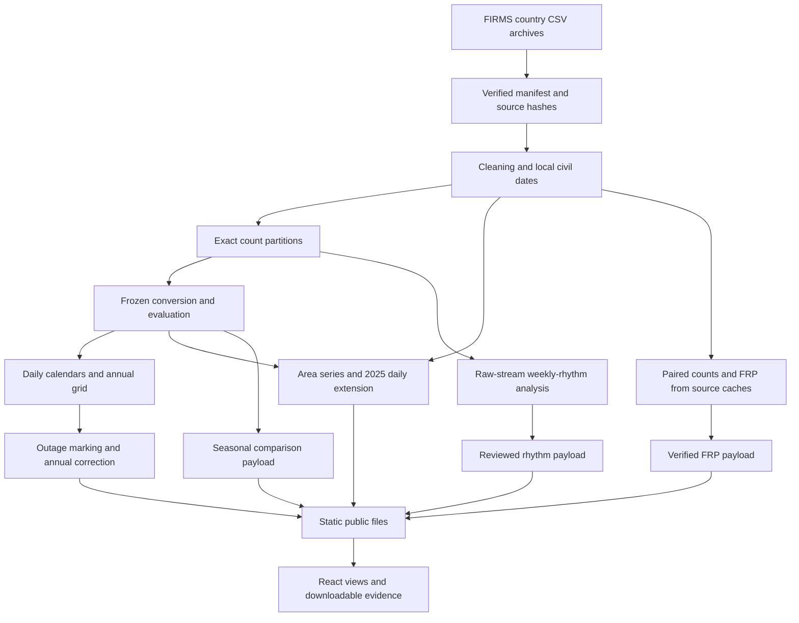

# Architecture

CINDERLINE has an offline Python analysis pipeline and a React application that reads static files. A country selection does not run a model on a server. The browser downloads the relevant published series, checks its format, and performs display calculations such as week grouping or summing cells inside a drawn area.

## From archives to the browser



The arrows show data dependencies, not a single automatic build command. The later feature exporters are separate stages. [Data and reproduction](05-data-and-reproduction.md) gives their commands and identifies stages that need original local caches.

The weekly-rhythm branch starts from each raw satellite stream. It does not use harmonized values to find the weekday pattern. The FRP comparison likewise retains separate streams and its own paired count/power definition.

## Python modules

| Module | Responsibility |
| --- | --- |
| [download.py](../pipeline/download.py) | Fetches annual archives, validates their headers, records row counts and hashes, and writes a manifest |
| [clean.py](../pipeline/clean.py) | Preserves satellite identity, applies confidence rules, parses acquisition times, resolves local civil dates and assigns grid cells |
| [streaming/aggregate_archives.py](../pipeline/streaming/aggregate_archives.py) | Cleans manifest-named files in chunks and writes exact count partitions with source/code identities |
| [streaming/prepare_analysis.py](../pipeline/streaming/prepare_analysis.py) | Reduces verified preparations into analysis tables |
| [streaming/evaluate_counts.py](../pipeline/streaming/evaluate_counts.py) | Fits and selects the candidate conversions, locks choices before held-out evaluation, or verifies a saved evaluation |
| [harmonize.py](../pipeline/harmonize.py) | Defines conversion strata, count predictions and comparison metrics |
| [streaming/prepared_runtime.py](../pipeline/streaming/prepared_runtime.py) | Applies the locked model to exact counts and creates daily series |
| [calendar.py](../pipeline/calendar.py), [streaming/stage_calendars.py](../pipeline/streaming/stage_calendars.py) | Produce regional calendars, seasonal summaries and downloadable calendar data |
| [streaming/prepared_globe.py](../pipeline/streaming/prepared_globe.py) | Builds the annual grid from the same frozen conversion |
| [streaming/estimate_dictionary.py](../pipeline/streaming/estimate_dictionary.py) | Encodes repeated values without changing their JSON value or type |
| [area_cells.py](../pipeline/area_cells.py) | Builds monthly series for the custom-area tool using national calibration |
| [extend_2025.py](../pipeline/extend_2025.py) | Appends the continuity year to national and selected daily-cell records without refitting |
| [reference/kill_test.py](../reference/kill_test.py) | Runs the official pre-specified weekly-rhythm test |
| [rhythm.py](../pipeline/rhythm.py), [streaming/weighted_rhythm.py](../pipeline/streaming/weighted_rhythm.py) | Run the separate raw-stream analysis and checks, including an exact-count implementation |
| [rhythm_web.py](../pipeline/rhythm_web.py) | Packages the official decision, separate checks and exploratory map for the app |
| [review/no_observation.py](../pipeline/review/no_observation.py) | Marks supplier gaps in fresh historical daily data and regenerates affected seasonal tables |
| [review/calendar_alignment.py](../pipeline/review/calendar_alignment.py) | Produces a source-bound annual deduction file that follows published daily exclusions |
| [review/season_check.py](../pipeline/review/season_check.py), [review/season_payload.py](../pipeline/review/season_payload.py) | Repeat the retained-date seasonal comparison and export independently checked summaries |
| [review/frp_test.py](../pipeline/review/frp_test.py) | Checks the paired US daytime count/FRP result and exports verified evidence |

The older [run_all.py](../pipeline/run_all.py) raw-record route remains available. The released seven-country model used the exact-count route recorded in [build_summary.json](../reports/build_summary.json). Aggregate rows contain a multiplicity `n`: consumers must sum `n`, not count rows as detections.

## Source identity and frozen results

The manifest identifies raw bytes. Preparations and reductions carry source fingerprints, while the model records its revision, country scope, training years and selected alternatives. Saved evaluations are reused only when their identities and hashes match. See [CONTRACTS.md](../CONTRACTS.md), [selection_lock.json](../reports/selection_lock.json) and [LOCKED_ARTIFACTS.json](../reports/LOCKED_ARTIFACTS.json).

The annual alignment is a separate derived artifact. Its browser decoder hashes the original cell order, year axis, source identity and annual numeric values before applying sparse deductions. Changed cell order, repeat application, unknown indexes or impossible deductions fail validation. The source globe and its arrays are not mutated. This lets the app correct display aggregation without rewriting the frozen model or evaluation.

The historical and continuity products have different coverage. National and selected daily-cell files run through 2025, while annual Earth and custom-area monthly data end in 2024. The seasonal baseline and official evaluation are not extended when later daily rows are appended. These boundaries are recorded in the country metadata, [extension report](../reports/review/extend2025/CONTINUITY.md) and [alignment report](../reports/calendar-confidence/OUTAGE_ALIGNMENT.md).

## Public data contracts

Paths below are relative to `web/public/data/`.

| File | Contract and consumer |
| --- | --- |
| `index.json` | Publication label, allowed region IDs/files, generated date, model revision and source fingerprint. `App.tsx` uses it before loading a country. |
| `<country>.json` | Metadata, compact national daily rows, seasonal summaries, anomalies, evaluation and selected-cell descriptors. Normalized to the `Region` type before use. |
| `cells/<country>_<cell>.json` | Compact daily rows for a selected cell. Loaded only when that cell is requested. |
| `<country>.csv`, `<country>.ics` | Earlier pipeline exports, not refreshed by the later JSON outage/extension stages. The UI generates downloads from the current loaded rows or selected guide year. |
| `globe.json` | Annual grid: ordered years, cell size, reference, country/source summaries, and cells with IDs, country, centre coordinates and nullable annual values. |
| `calendar-alignment.json` | `calendar-dates-v1`, source identities, retained-date metadata and `indexed-deduction-dictionary-v1` annual corrections. Applied only to its matching globe. |
| `area/<country>.json` | Parallel cell-centre arrays and sparse monthly series, with model, period, units, outage months and a local-accuracy note. |
| `rhythm.json` | Official decision, per-stream weekday results, separate checks, controls and interpretation notes. |
| `rhythm_cells.json`, `rhythm_cells_summary.json` | Compact exploratory cell results and their summary, separate from the national decision. |
| `frp.json` | Verified count-versus-power comparison and links to public evidence files. |
| `season-comparison.json` | National retained-month counts and shares, mask choices, published summary metrics and verification lineage. |
| `world-land.json`, `world-outline.json` | Static map context produced from the locked `world-atlas` dependency. |

The TypeScript contracts are declared in [types.ts](../web/src/types.ts) and the corresponding feature modules. Runtime checks are implemented in [loadData.ts](../web/src/loadData.ts), [globeData.ts](../web/src/globeData.ts), [calendarAlignment.ts](../web/src/calendarAlignment.ts), [areaSelection.ts](../web/src/areaSelection.ts), [rhythmData.ts](../web/src/rhythmData.ts) and [seasonComparisonData.ts](../web/src/seasonComparisonData.ts). Their depth varies: the daily loader checks dictionary structure, and the area loader checks basic array shape. Type declarations alone do not validate every fetched numeric value.

### Daily rows and dictionary encoding

A daily row carries its date and cell ID, separate raw Terra/Aqua/VIIRS counts, the constructed raw baseline, the harmonized value, calibration bounds, source, model and coverage text. Missing values are null. A recorded zero remains a number; it does not establish full observation coverage.

National rows are stored as `daily_compact`. Selected-cell files use the same `column-dictionary-v1` table shape:

```text
encoding
columns
rows
dictionaries
```

A row entry is a dictionary index only if that column appears in `dictionaries`. Otherwise it is a literal value. The reader rejects unknown encodings, malformed row lengths and invalid dictionary indexes. It also rejects a country file containing both `daily` and `daily_compact`. Older plain daily tables remain readable. These rules are implemented in [loadData.ts](../web/src/loadData.ts).

### Area series

The area payload uses a separate, lossy display format. Its sparse pairs contain a month-index delta followed by a value in tenths. The client reconstructs month indexes, sums selected cells and divides by ten. Cell centres inside a rectangle or radius determine membership; the app does not clip a cell fraction at the selection boundary. See [areaSelection.ts](../web/src/areaSelection.ts).

That distinction matters when comparing totals. The area data round each cell-month and omit whole months affected by exclusions. The corrected annual globe sums retained daily contributions. They have different precision and included dates, so their totals are not required to match. This is documented in the payload notes and [OUTAGE_ALIGNMENT.md](../reports/calendar-confidence/OUTAGE_ALIGNMENT.md).

## Frontend structure

[main.tsx](../web/src/main.tsx) mounts [App.tsx](../web/src/App.tsx). The app owns the selected country, date range, spatial scope, raw/harmonized display, page and evidence week. It loads the index, then the selected country, then a selected daily-cell file if needed.

The main components follow those responsibilities:

| Component or helper | Role |
| --- | --- |
| `App.tsx`, `calendarView.ts`, `utils.ts` | Main views, weekly calendar, week grouping and evidence drawer |
| `MonthCalendar.tsx`, `monthStats.ts` | Monthly calendar and historical month comparisons |
| `AreaOfInterest.tsx`, `areaSelection.ts` | Drawn/typed area selection and monthly sums |
| `ComparisonChart.tsx`, `ComparisonJourney.tsx` | Raw, converted and reference comparisons and links into evidence |
| `SeasonComparison.tsx`, `seasonComparisonData.ts` | National count and seasonal-shape comparisons on the study's fixed years |
| `SeasonalContext.tsx`, `AnomalyPanel.tsx` | Historical seasonal guide and unusual-week views |
| `ReliabilityNotice.tsx`, `reliability.ts` | Evaluation scope, date completeness and uncertainty wording |
| `RhythmView.tsx`, `RhythmCellMap.tsx`, `FrpComparison.tsx` | Weekly-rhythm decision, exploratory map and paired power comparison |
| `Globe.tsx`, `globeCells.ts`, `globeViewport.ts` | Annual Earth rendering, country/cell selection, camera fitting and table alternative |
| `ShareView.tsx`, `explorationState.ts`, `explorationIntegration.ts` | Share-link parsing, recovery and restored selections |
| `evidenceBrief.ts`, `comparisonExport.ts` | Downloadable evidence and comparison tables |

These files are under [web/src/](../web/src/). React, TypeScript and Vite are pinned in the [web package files](../web/package.json). Three.js renders Earth. Other views use HTML and SVG; the area map also draws its cells on a 2D canvas, with an SVG selection overlay.

The globe is a lazy import and opens only after the user requests it. Seasonal comparison code is also a lazy import. Country, cell, area, rhythm and FRP data have their own loading boundaries; opening one feature does not fetch every scientific payload.

`loadData.ts` caches successful resources and tracks invalidation generations. An aborted or older request cannot repopulate a resource after a newer retry. Components use `AbortController` and selection keys to avoid presenting a previous country's data as the current country. Errors expose retry paths instead of substituting synthetic observations.

The Earth renderer uses [demandRenderer.ts](../web/src/demandRenderer.ts): controls and data changes request frames, and visibility changes pause rendering. [globeCells.ts](../web/src/globeCells.ts) distinguishes selection from drag and resolves overlapping border cells before filtering values. A selected-country null cannot be replaced by a neighbouring country's number.

Share links restore allowed region/cell IDs, dates, page, scale and an optional evidence week. They refer to the current publication, not immutable data snapshots. Camera position and Earth/table preference are not stored. Invalid or unavailable values recover with visible notices rather than silent substitutions.

## Tests and independent checks

Python tests cover cleaning, local-date boundaries, model selection, exact-count processing, dictionary round trips, calendar gaps, area aggregation, extension behavior and the reviewed analysis exporters. Browser-module tests cover payload decoding, chart calculations, selection state, sharing, stale requests, errors, evidence exports and Earth interaction logic. The web runner discovers suites from [web/tests/](../web/tests/) after its named prechecks.

Independent scientific checkers live alongside the build scripts. For example, [verify_calendar_alignment.py](../scripts/verify_calendar_alignment.py) reconstructs deductions without importing the producer, and [verify_frp_test.py](../scripts/verify_frp_test.py) recalculates the paired analysis from its source caches. [verify_season_check.py](../scripts/verify_season_check.py) and the seasonal payload checks serve different stages: the former checks the analysis, while the latter checks the browser export against verified outputs.

Automated modules do not prove that every browser or GPU renders correctly. Release checks also open the built app at desktop and phone widths, inspect loading and recovery, exercise evidence and area selection, restore a share link, and open Earth. The commands are in [data and reproduction](05-data-and-reproduction.md).

## Build and hosting

The root [build script](../scripts/build.mjs) regenerates map context, runs TypeScript, invokes Vite and prepares `dist/`. [Cloudflare Pages](https://cinderline-spaceapps.pages.dev/) serves those static assets. There is no application database, server-side prediction endpoint or deployed Worker function in this architecture.

Wrangler Direct Upload publishes only when explicitly run. A Git commit does not update the site. [publish.ps1](../scripts/publish.ps1) is an optional release command that runs checks, pushes a named branch through the `github` remote, deploys and verifies assets. It builds the current checkout without checking that its branch matches the named branch, so the operator must verify that match first. It must not be used for a review-only run.

[verify_deployment.py](../scripts/verify_deployment.py) compares built and served bytes by SHA-256. Its receipt identifies the URL and verification time. It does not prove that the published code matches a later Git checkout, and an old passing receipt is not evidence for a newer deployment.
